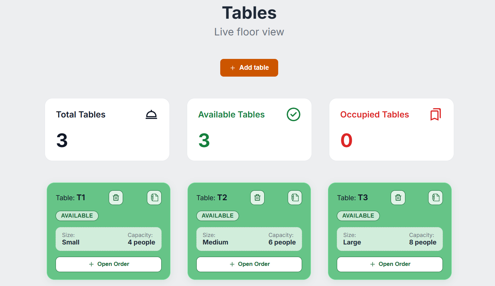
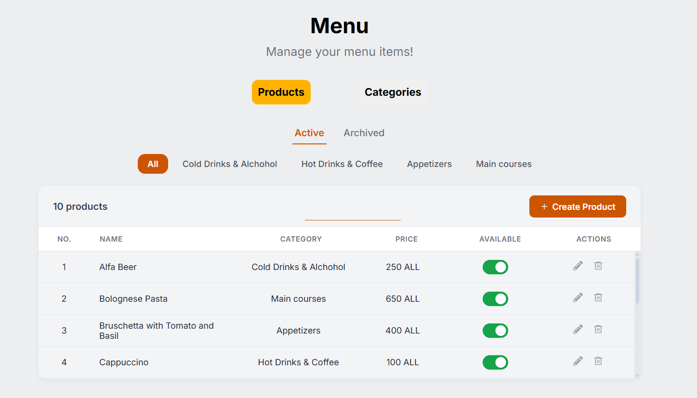
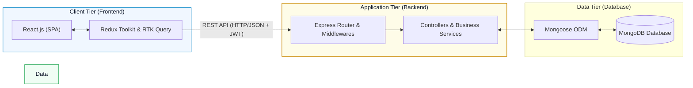
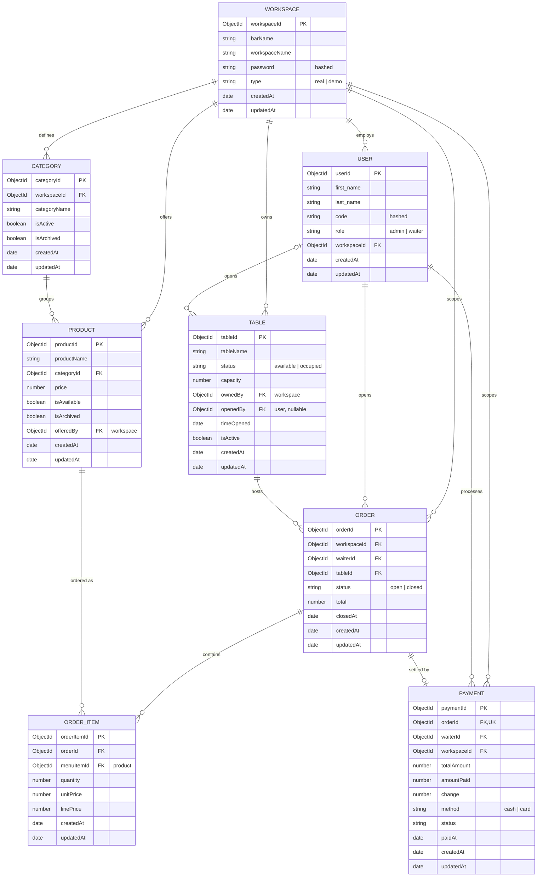

# BarPOS

# Project Overview

BarPOS is a full-stack Point of Sale (POS) and restaurant management application designed to simplify order management and daily operational workflows within bars and restaurants.

The application is primarily designed for small and medium-sized businesses, providing a centralized platform that helps owners and staff manage essential operations, improve visibility into daily activities and monitor overall business performance.

BarPOS includes features such as table management, menu and product management, order processing, payment handling, total revenue analytics over selected time periods and performance insights for administrators and waiters.

## Application Screenshots

1. Table Management

The Table Management page provides an overview of all restaurant tables and their current status, visually represented through different colors.

Administrators can perform CRUD operations on tables, including creating, editing, and deleting them. Users can also initiate a new order directly from a table card using the Open Order action.

2. Order Proccessing

The Order Processing page is divided into three main components:

Categories Panel: Displays all menu categories available within the workspace.

Products Panel: Dynamically displays products belonging to the selected category.

Order Ticket: Displays the products added to the current order, calculates the order total, and provides actions to proceed to checkout, discard the order, or return to the Table Management page.

3. Payment Management

The Payment Management page provides an overview of completed payments within a selected time period.

A revenue summary card displays the total revenue based on the selected time filter, while the payment list provides details of individual transactions. Administrators can also view the receipt associated with each payment.

4. Menu Management

The Menu Management page is organized into two related sections: Categories and Products.

Administrators can perform CRUD operations on both categories and products. Each product belongs to a category and changes to a category can directly affect the availability and visibility of its associated products within the menu.

For example, when a category is deactivated, its products become unavailable for order processing. Also, archiving or deleting a category affects its associated products according to the application's business rules, ensuring that the menu remains consistent.

## Key Features

1. Role-Based Access Control

- Two user roles: Admin and Waiter, each with different permissions and access to application features.
- Role-based restrictions are enforced across frontend pages and backend API operations.

2. Table Management

- Admins can create, edit, and delete workspace tables.
- Each table displays its current status.
- Both Admins and Waiters can initiate orders directly from table cards.

3. Menu Management

- Admin-only access to category and product management.
- Full CRUD operations with a one-to-many relationship between categories and products.
- Business rules handle product availability, archiving, and deletion based on category status and order history.

4. Payment Management

- Revenue analytics covering selected periods, last month, and all-time revenue.
- Payment history with filters for date range and payment method.
- Administrators can view detailed receipts for completed payments.

5. Profile & Performance Analytics

- Personal profile information and role-specific performance insights.
- Admins can monitor daily order counts across Waiters.
- Waiters can track their own daily and all-time order counts.
- Admins can register new employees within their workspace.

6. Two-Stage Authentication

- Workspace authentication using workspace credentials, followed by individual employee authentication using a personal access code.
- Employee access codes are unique within their respective workspaces.

7. Workspace-Level Data Isolation

- Each workspace operates within its own isolated data environment.
- Backend API operations enforce workspace ownership and prevent unauthorized cross-workspace data access.

8. Data Consistency & Concurrent Updates

- MongoDB transactions and atomic updates help maintain data consistency during order operations.
- Unique compound indexes enforce data integrity and prevent duplicate records.

## Tech stack

### Frontend
- **React.js** – User interface development.
- **Redux Toolkit** – Global state management.
- **RTK Query** – API integration, data fetching, caching and cache invalidation.

### Backend
- **Node.js** – JavaScript runtime environment.
- **Express.js** – Backend framework for building RESTful APIs.
- **JWT (JSON Web Tokens)** – Authentication and token-based access control.
- **Node-Cron** – Scheduled background tasks.
- **Helmet.js** – HTTP security headers.
- **CORS** – Cross-origin resource sharing.
- **Mongoose** – MongoDB object data modeling (ODM).

### Database
- **MongoDB** – NoSQL database for storing application data.

## Architecture & Project Structure

### Application Architecture

BarPOS follows a client-server architecture, separating the frontend, backend, and database into distinct layers.

The React frontend communicates with the Express backend through RESTful APIs. The backend handles authentication, authorization, business logic, and database operations, while MongoDB stores application data through Mongoose ODM.

### Project Structure

The codebase is organized into separate frontend and backend modules, following a modular structure with clear separation of responsibilities.

#### Backend

- config/ – Database and application configuration.
- routes/ – REST API endpoint definitions.
- controllers/ – HTTP request and response handling.
- services/ – Business logic and database operations.
- models/ – Mongoose schemas and data models.
- middlewares/ – Authentication, authorization, and request handling.
- jobs/ – Scheduled background tasks.

#### Frontend

- components/ – Reusable UI components.
- pages/ – Application pages and views.
- layout/ – Application layout and navigation.
- store/apis/ – RTK Query API definitions.
- store/slices/ – Redux state management.
- utils/ – Shared utility functions.

## Authentication & Authorization

BarPOS implements a two-stage authentication system combined with role-based authorization and workspace-level data isolation.

- Workspace Authentication: Users first authenticate using their workspace credentials to access the corresponding workspace.
- Employee Authentication: After workspace authentication, employees log in using their personal access codes, which are unique within their workspace.
- Role-Based Authorization: The system supports Admin and Waiter roles, each with different permissions enforced through frontend route protection and backend middleware.
- Workspace Data Isolation: Backend operations verify workspace ownership to prevent unauthorized access to resources belonging to other workspaces.

## Database Design

### ER Diagram

### Entity Relationships

## Database Design

### Relationships

| Relationship | Cardinality | Description |
|---|---|---|
| Workspace → User | 1 : N | A workspace employs many users; each user belongs to one workspace. |
| Workspace → Table | 1 : N | A workspace owns many tables. |
| Workspace → Category | 1 : N | A workspace defines many categories. |
| Workspace → Product | 1 : N | A workspace offers many products. |
| Workspace → Order | 1 : N | Every order belongs to one workspace. |
| Workspace → Payment | 1 : N | Every payment belongs to one workspace. |
| User → Table | 1 : N (optional) | A user can have opened many tables. A table is opened by at most one user (`openedBy` is null when available). |
| User → Order | 1 : N | Each order is opened by exactly one user; a user opens many orders. |
| User → Payment | 1 : N | Each payment is processed by exactly one user. |
| Table → Order | 1 : N | A table can host many orders over time, but at most one with status `open` at a time. |
| Order → OrderItem | 1 : N | An order contains many order items. |
| Order → Payment | 1 : 0..1 | A closed order is settled by exactly one payment; open orders have none. |
| Category → Product | 1 : N | A category groups many products. |
| Product → OrderItem | 1 : N | A product appears in many order items across orders. Within one order it appears once, with a `quantity`. |

