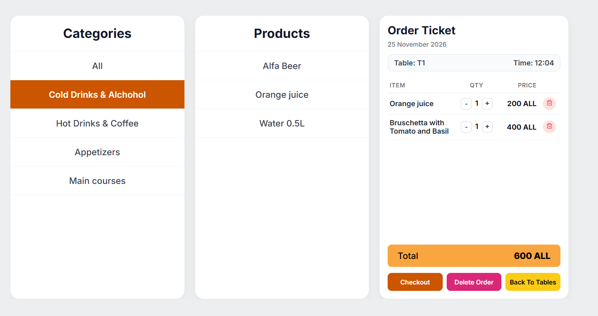
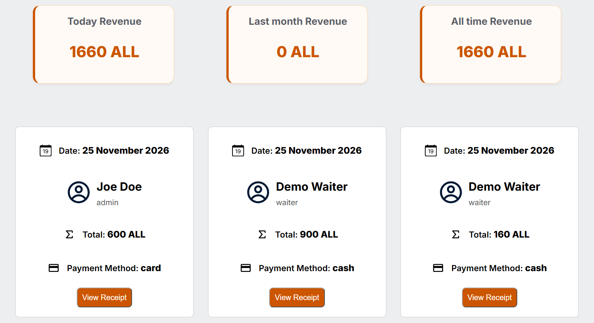

# BarPOS

# Project Overview

BarPOS is a full-stack Point of Sale (POS) and restaurant management application designed to simplify order management and daily operational workflows within bars and restaurants.

The application is primarily designed for small and medium-sized hospitality businesses, providing a centralized platform that helps owners and staff manage essential operations, improve visibility into daily activities and monitor overall business performance.

BarPOS includes features such as table management, menu and product management, order processing, payment handling, total revenue analytics over selected time periods and performance insights for administrators and waiters.

## Application Screenshots

1. Table Management

The Table Management page provides an overview of all restaurant tables and their current status, visually represented through different colors.

Administrators can perform CRUD operations on tables, including creating, editing, and deleting them. Users can also initiate a new order directly from a table card using the Open Order action.

2. Order Proccessing

The Order Processing page is divided into three main components:

Categories Panel: Displays all menu categories available within the workspace.

Products Panel: Dynamically displays products belonging to the selected category.

Order Ticket: Displays the products added to the current order, calculates the order total, and provides actions to proceed to checkout, discard the order, or return to the Table Management page.

3. Payment Management

The Payment Management page provides an overview of completed payments within a selected time period.

A revenue summary card displays the total revenue based on the selected time filter, while the payment list provides details of individual transactions. Administrators can also view the receipt associated with each payment.

4. Menu Management

The Menu Management page is organized into two related sections: Categories and Products.

Administrators can perform CRUD operations on both categories and products. Each product belongs to a category and changes to a category can directly affect the availability and visibility of its associated products within the menu.

For example, when a category is deactivated, its products become unavailable for order processing. Also, archiving or deleting a category affects its associated products according to the application's business rules, ensuring that the menu remains consistent.
